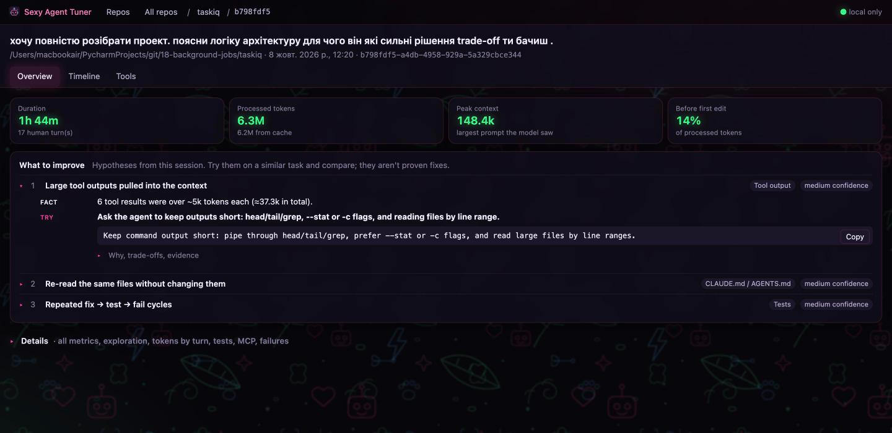
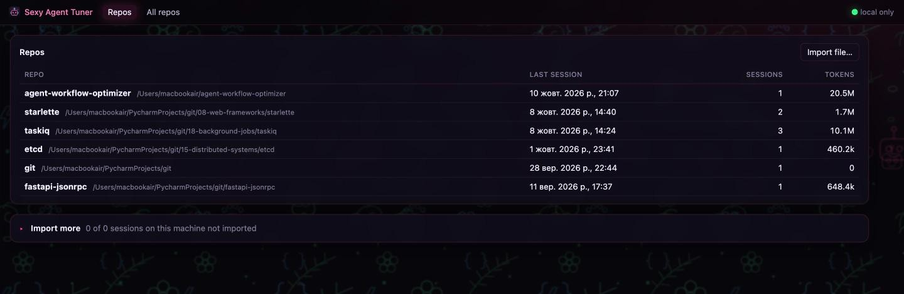
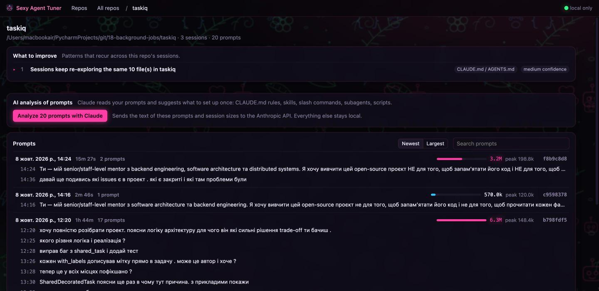
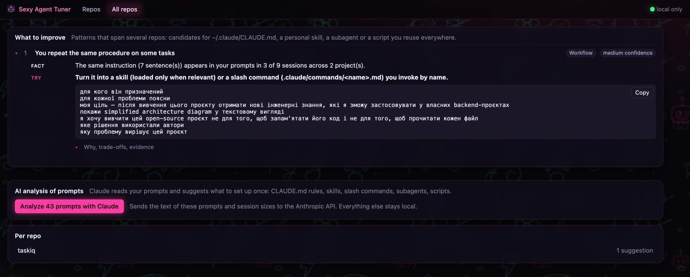
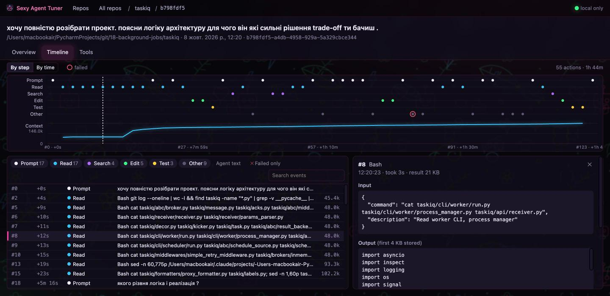

<p align="center"></p>

<h1 align="center">Sexy Agent Tuner</h1>

<p align="center">
  <b>See where your coding agent burns tokens, and what to change so the next session doesn't.</b><br>
  Local-first analysis of Claude Code sessions: prompts, tools, context growth, and concrete fixes<br>
  for your prompts, <code>CLAUDE.md</code>, skills, subagents and scripts.
</p>

<p align="center">
  
  
  
</p>

<p align="center">
  
</p>

---

## Why

Claude Code writes every session to `~/.claude/projects/**/*.jsonl`. These logs say exactly what
happened (every prompt, tool call, result and token count), but nobody reads them: one message is
split across lines, tool results live apart from their calls, and subagents write to separate files.

So the expensive questions go unanswered:

- Why did this session process **236M tokens**?
- Why does the agent re-read the same ten files at the start of **every** task?
- Which instructions do I keep **retyping** that should live in `CLAUDE.md` or a skill?

Sexy Agent Tuner parses those logs, measures what happened, and turns the patterns into suggestions
you can copy. Metrics and rules are computed, not guessed, and every suggestion links back to the exact
events that triggered it. An optional AI pass reads your prompts for what the rules can't see, such as the
same request worded differently, and is held to the same standard: each finding cites the prompts behind it.

## Features

- **Repos → prompts → sessions.** Sessions are grouped by repository. Open a repo to see every prompt
  you typed there, with each session's size (processed tokens, peak context) so the heavy ones stand out.
- **Findings, not dashboards.** Each suggestion separates the **fact** (measured) from the
  **hypothesis** (what it might mean) and gives a **snippet** to paste into a prompt or `CLAUDE.md`,
  plus the expected benefit, the possible downside and the evidence.
- **Across sessions and repos.** Finds instructions you repeat, files every session re-explores and
  tool chains the agent keeps rebuilding, then says whether they belong in `CLAUDE.md`, a skill or slash
  command, a subagent, or a script.
- **Timeline.** Behavior lanes (read, search, edit, test, MCP, subagents) and context growth on one axis.
  Click any mark to see the event's full input and output.
- **AI analysis of prompts (optional).** Claude reads your prompts, groups intents you repeat even when worded
  differently, and suggests CLAUDE.md rules, skills, slash commands, subagents or scripts, each traced back to the prompts.
- **Local first.** Everything is parsed and stored on your machine (`~/.awo/awo.db`). Only the AI analysis sends
  anything off the machine (prompt text and session sizes, to the Anthropic API), and only when you press its button.

## Screenshots

**Repos.** Every project you've used the agent in, with its sessions and total tokens.



**Repo.** What recurs across this repo's sessions, the AI analysis of its prompts, and every prompt grouped
by session. Size bars show the big sessions at a glance, and a click opens the session at that prompt.



**All repos.** Patterns that span several projects (candidates for `~/.claude/CLAUDE.md`, a personal
skill, a subagent or a reusable script), plus the AI analysis across every repo.



**Timeline.** What the agent did, step by step, and how the context grew.



## Quick start

**Requirements:** Go 1.25+, a C compiler (SQLite via cgo), Node 20+, and the
[Wails v2 CLI](https://wails.io/docs/gettingstarted/installation)
(`go install github.com/wailsapp/wails/v2/cmd/wails@latest`). Developed on macOS.

### Desktop app

```sh
git clone https://github.com/zakharkiv-vitalik/sexy-agent-tuner
cd sexy-agent-tuner/app
wails build                       # → app/build/bin/sexy-agent-tuner.app
open build/bin/sexy-agent-tuner.app
```

On first launch, open **Import more** and press **Import all**. The app finds your sessions in
`~/.claude/projects` by itself. For live reload while hacking on the UI, run `wails dev`.

### CLI

```sh
cd app && wails build && cd ..    # once: the Go module embeds the built frontend
go build -o bin/sat ./cmd/sat

bin/sat import ~/.claude/projects/*/*.jsonl
bin/sat sessions                  # list imported sessions
bin/sat show <id-prefix>          # metrics + findings for one session
bin/sat show <id-prefix> --timeline
bin/sat show <id-prefix> --json   # full report, for tooling
bin/sat insights [--project DIR]  # patterns recurring across sessions
bin/sat analyze [--project DIR]   # AI analysis of prompts (Anthropic API, see below)
```

The CLI and the app share the same database.

### AI analysis

Needs an Anthropic API key in `ANTHROPIC_API_KEY`, or saved to `~/.awo/anthropic_api_key` (the desktop app,
started from Finder, doesn't see shell variables):

```sh
printf %s 'YOUR_KEY' > ~/.awo/anthropic_api_key && chmod 600 ~/.awo/anthropic_api_key
```

It uses `claude-opus-5-5` with a JSON schema for the answer. The newest prompts are sent until a ~120k-character
budget is spent, and the result says how many were analyzed. Results are stored per repo, so reopening costs nothing;
an unchanged prompt set isn't re-sent unless you re-run it. Calls are billed per token on your API account.

## What it looks for

Thresholds are deliberately conservative: a short list you trust beats a long one you ignore.
Findings are hypotheses to try on your next similar task, not proven fixes.

**In one session**

| Rule | Fires when | Typical fix |
|---|---|---|
| `redundant-reads` | files are re-read with no edit in between | key-files map in the prompt or `CLAUDE.md` |
| `broad-search` | repo-wide greps/globs before knowing where to look | name a starting point, or trace from a known entry point |
| `exploration-heavy` | most tokens go to exploring before the first edit | Explore subagent or a plan-first step |
| `large-outputs` | tool results over ~5k tokens each | `head`/`grep`/`--stat`, read by line range |
| `test-failures` | repeated fix → test → fail cycles | ask the agent to explain each failure before changing code |
| `no-tests` | code changed but no tests were run | put the verification command in the prompt or `CLAUDE.md` |
| `repeated-calls` | the exact same tool call runs more than once | have the agent note key findings instead of re-running |
| `heavy-turn` | one prompt consumed most of the session | goal / expected result / done-when |
| `mcp-before-edit` | external systems queried before a code-level hypothesis | ask for a hypothesis before querying |
| `mcp-heavy` | most of the work goes step by step through one MCP server | a script or skill for the routine |

**Across sessions and repos**

| Rule | Fires when | Suggests |
|---|---|---|
| `repeated-instructions` | the same sentences appear in your prompts in 3+ sessions | in most sessions: `CLAUDE.md` (user-level if across repos); otherwise a skill or slash command |
| `repeated-exploration` | the same files are read before the first edit in 3+ sessions | a key-files map in the project's `CLAUDE.md` |
| `repeated-chain` | the same 3-step tool sequence runs in 3+ sessions | read-only: subagent · with edits: skill · commands: script or hook |

**AI analysis of prompts** (on demand)

Claude gets your prompts grouped by session, with each session's size, and looks for recurring intents
(in any language, however they're worded), recurring procedures, and habits that go with big sessions:
open-ended requests, strings of "show the result" follow-ups, missing done-criteria. Each finding is filed
as a `CLAUDE.md` rule, a skill, a slash command, a subagent, a script or a prompt habit, with a snippet
written in the language you prompt in. Findings must cite prompts; one that cites none that exist is dropped.

## How it works

```
~/.claude/projects/**/*.jsonl
        │  stream line by line, dedupe split messages, join tool results, pull in subagents
        ▼
session.Session            provider-independent model: user_prompt · model_call · assistant_text · tool_call
        │
storage (SQLite)           one events table, re-import replaces
        │
analysis.Analyze           deterministic facts: tokens, tools, files, tests, MCP, failures, timeline
        │                  every fact points at event seqs as evidence
insight.Generate / Across  rules → findings (fact · hypothesis · snippet · benefit · downside · evidence)
        │
llm.Analyze (on demand)    prompts + session sizes → Claude → findings citing prompts, cached per repo
        │
CLI (cmd/sat)  ·  desktop app (app/, Wails + Svelte)
```

| Package | Role |
|---|---|
| `internal/session` | Domain model + Claude Code adapter. Malformed lines become warnings instead of failures. |
| `internal/storage` | SQLite store, schema embedded. |
| `internal/analysis` | `Classify` maps tool calls to behavior, including Bash equivalents (`cat`, `sed -n`, `grep -r`, heredoc writes, `go test`…). `Analyze` builds the report. |
| `internal/insight` | Per-session rules (`Generate`) and cross-session rules (`Across`). |
| `internal/llm` | AI analysis of prompts via the Anthropic Go SDK, with a JSON-schema answer and a per-scope cache. |
| `cmd/sat` | Cobra CLI. |
| `app` | Wails desktop app; `app/frontend` is Svelte 5. |

## Limits

- Claude Code is the only supported agent so far. The session model is provider-independent, so
  other agents need only an adapter.
- The deterministic cross-session rules match exact sentences (4+ words); rephrased instructions are left to the AI analysis.
- Bash commands are classified with a whitespace tokenizer, not a real shell parser.
- MCP relevance is always `unknown`: metrics alone can't tell whether a call was needed.

## Roadmap

- LLM postmortem of a single session over a compact evidence package (never the raw logs)
- Experiments: compare sessions before and after a prompt or `CLAUDE.md` change

```sh
go test ./...
```
